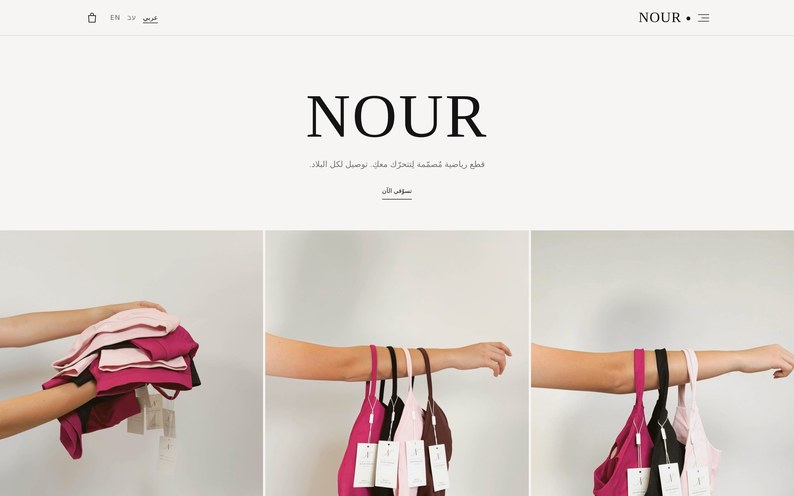
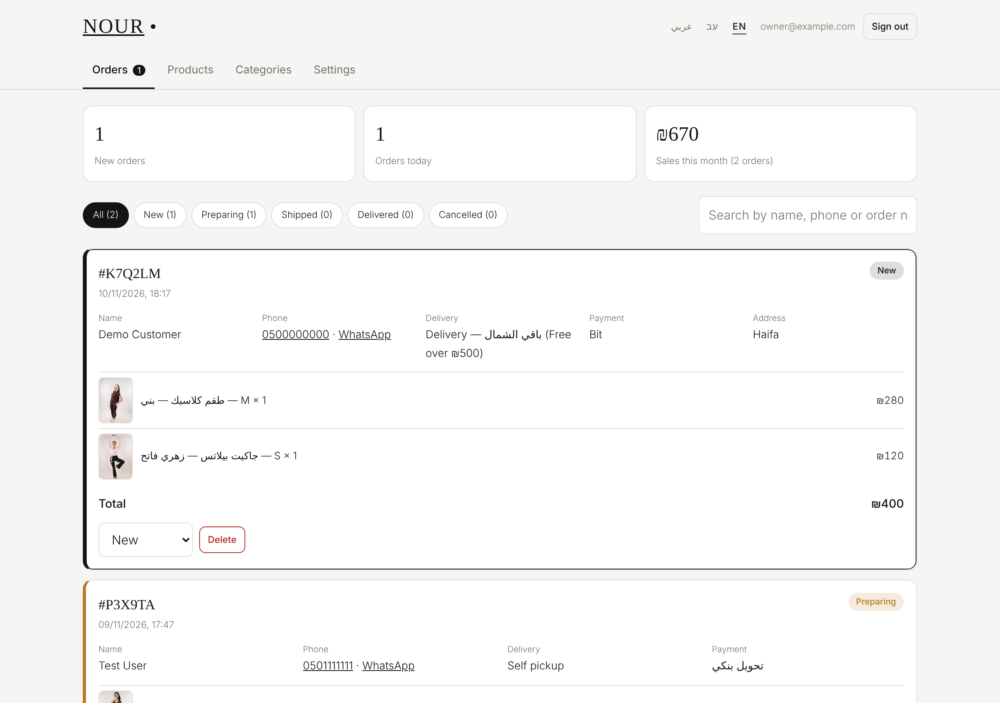
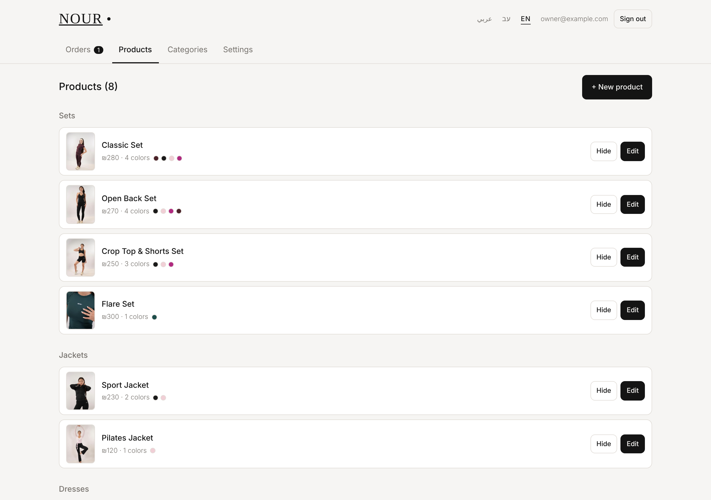
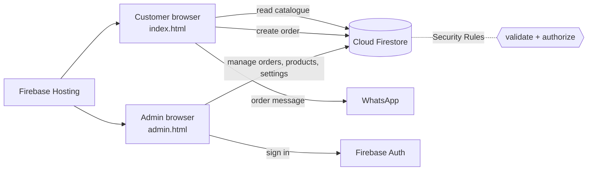
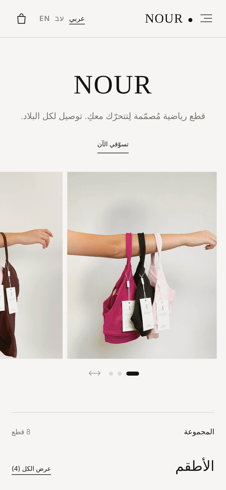
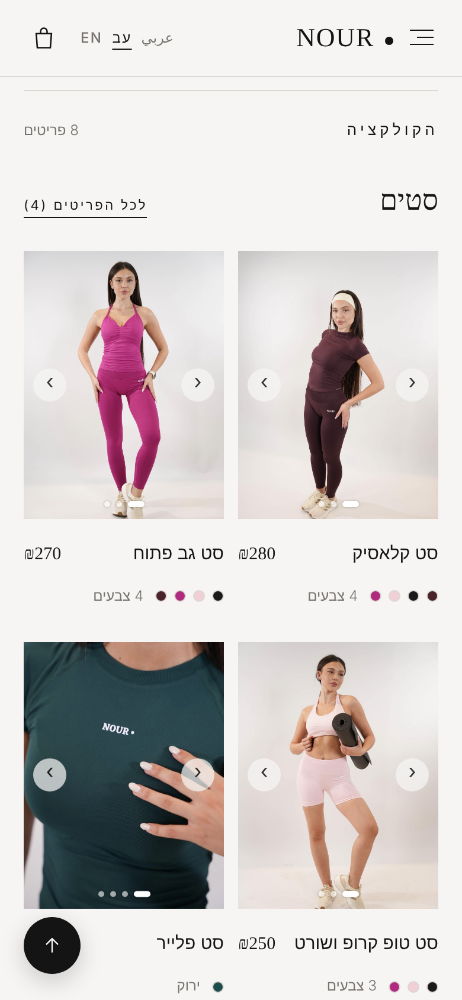
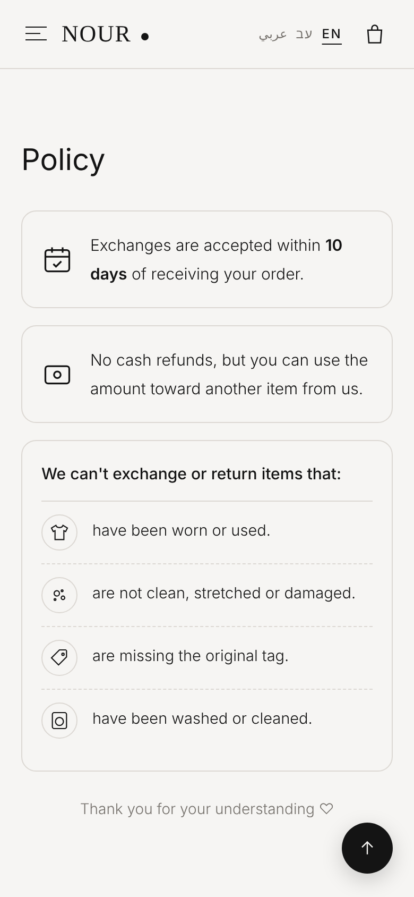
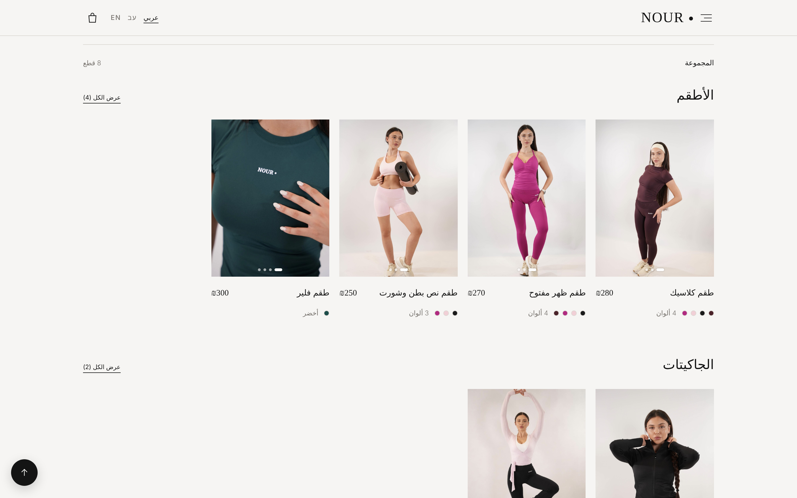
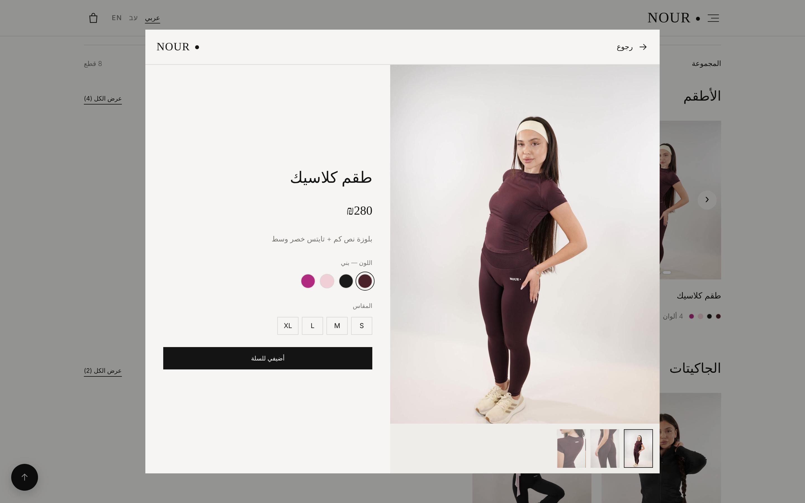
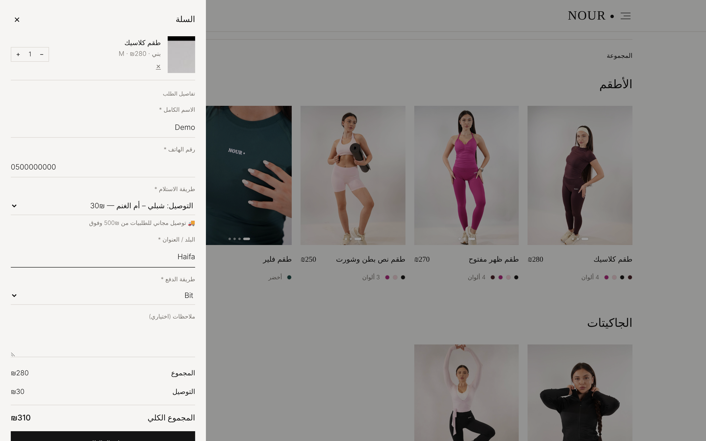

# NOUR · Sportswear Store

A full-stack, serverless e-commerce web app for **Sportswear By NOUR**, a women's activewear brand.
It has a storefront in three languages (Arabic, Hebrew and English) and an admin dashboard where the store owner manages orders, products and settings. There is no custom server: the backend runs on Firebase.



> **Live site:** https://sportswear-by-nour.web.app

---

## Features

### Storefront
- **Three languages with RTL and LTR layouts.** Arabic, Hebrew and English, switchable at any time.
- **Product catalogue grouped by category.** Each product has a photo gallery for every color, size selection and a sold-out state.
- **Cart and checkout.**
  - Delivery zones with their own prices, plus self pickup.
  - Free delivery on orders of ₪500 or more.
  - The customer chooses a payment method: Bit, cash to the courier, bank transfer or pay at pickup.
- **Orders go two ways.** Each order is saved to Firestore and also opens a pre-filled WhatsApp message with the same order number.
- **Brand pages.** A story section, a returns and exchange policy, a splash screen and subtle animations.
- **Mobile-first and responsive**, with keyboard support and semantic, accessible markup.

### Admin dashboard (`/admin`)
- **Password-only login** for the store owner, using Firebase Authentication.
- **Live orders.**
  - New orders appear in real time.
  - Status pipeline: new → preparing → shipped → delivered, or cancelled.
  - Search, filters, product thumbnails in the ordered color, and one-tap WhatsApp to the customer.
- **Stats:** new orders, orders today and sales this month.
- **Product management.**
  - Create, edit, hide and delete products, and mark them as sold out.
  - Each product has a name and description in all three languages, a price, sizes and colors.
  - Photo galleries per color. Photos are resized in the browser before upload.
- **Categories and settings:** delivery zones and prices, and the WhatsApp number.
- **The dashboard itself is in three languages.**
- **Versioned data migrations.** Catalogue updates are applied once and never overwrite the owner's own edits.

| Orders | Products |
|---|---|
|  |  |

---

## Tech stack

| Layer | Technology |
|---|---|
| Frontend | Vanilla **JavaScript** (ES modules), **HTML5** and **CSS3**, with no framework and no build step |
| Database | **Cloud Firestore**, a NoSQL real-time database |
| Auth | **Firebase Authentication** with email and password |
| Security | **Firestore Security Rules**, which validate and authorize every request on the server |
| Hosting | **Firebase Hosting** with HTTPS and CDN cache headers |
| Messaging | WhatsApp deep links (`wa.me`) |

### Architecture



### Data model (Firestore)

| Collection | Contents | Who can write |
|---|---|---|
| `products` | name and description (ar, he, en), price, sizes, colors and photos, flags | admin |
| `categories` | name (ar, he, en), order | admin |
| `settings/store` | delivery zones, WhatsApp number, data version | admin |
| `images` | uploaded photos (compressed, under 900 KB each) | admin |
| `orders` | items, customer, delivery, payment, totals, status | anyone can **create** a validated order; only the admin can read or update |
| `admin/{uid}` | marks which user is the store owner | Firebase Console only |

### Security
- **HTTPS everywhere**, through Firebase Hosting.
- **Firebase Authentication** for the dashboard.
- **Server-side Security Rules.**
  - Customers can only read the catalogue and create orders.
  - Every new order is validated: allowed fields only, field types and lengths, item count, and the status must be `new`.
  - Only an authenticated user listed in `admin/{uid}` can read orders or change the catalogue.
- **No card data** is ever handled by the site.

---

## Project structure

```
├── index.html            # Storefront
├── admin.html            # Admin dashboard
├── css/
│   ├── style.css         # Storefront styles
│   └── admin.css         # Dashboard styles
├── js/
│   ├── store.js          # Storefront logic: i18n, catalogue, cart, checkout
│   ├── admin.js          # Dashboard logic: orders, products, settings
│   ├── admin-i18n.js     # Dashboard translations
│   ├── data.js           # Default catalogue + versioned data migrations
│   ├── images.js         # Bundled product photo map
│   └── firebase-config.js# Firebase web config (fill in your own)
├── assets/               # Logo, brand and product photos
├── firestore.rules       # Security Rules
├── firebase.json         # Hosting config
└── docs/                 # Screenshots + setup guide (Arabic)
```

---

## Run locally

The site is static, so any local web server works:

```bash
npx serve .
# or
python3 -m http.server 5500
```

Then open `http://localhost:5500`.

While `apiKey` in `js/firebase-config.js` is empty, the store runs in **demo mode** with the built-in catalogue. In demo mode orders open WhatsApp only and are not saved.

## Deploy your own

1. Create a Firebase project and enable **Firestore** and **Authentication** (Email/Password).
2. Copy your web app config into `js/firebase-config.js`, and put your project ID in `.firebaserc`.
3. Create the owner user in Authentication.
4. In Firestore, add a document `admin/{OWNER_UID}` with the field `role: "owner"`.
5. Deploy:

```bash
npm install -g firebase-tools
firebase login
firebase deploy --only hosting,firestore
```

6. Open `/admin`, sign in and click **Add starter products**.

There is a detailed step-by-step guide in Arabic in [`docs/SETUP-ar.md`](docs/SETUP-ar.md).

---

## Screenshots

| Mobile | Hebrew catalogue | Policy (English) |
|---|---|---|
|  |  |  |

| Catalogue | Product | Cart and checkout |
|---|---|---|
|  |  |  |

---

## בעברית בקצרה

אפליקציית מסחר אלקטרוני **Full Stack (Serverless)** למותג בגדי הספורט NOUR:
- **חנות** בשלוש שפות (ערבית, עברית ואנגלית), עם סל קניות, אזורי משלוח, משלוח חינם מ־₪500, בחירת אמצעי תשלום ושליחת הזמנה ל־WhatsApp.
- **לוח ניהול** לבעלת החנות, עם הזמנות בזמן אמת, ניהול מוצרים, צבעים, תמונות ומלאי, וסטטיסטיקות.
- **צד לקוח:** JavaScript, HTML ו־CSS, בלי פריימוורק.
- **צד שרת:** Firebase, כלומר Firestore, Authentication, Security Rules ו־Hosting.

---

## Notes

- The code is the developer's work. Brand name, logo and product photos belong to **Sportswear By NOUR** and are included for demonstration only.
- Contact details in this repository are placeholders.
